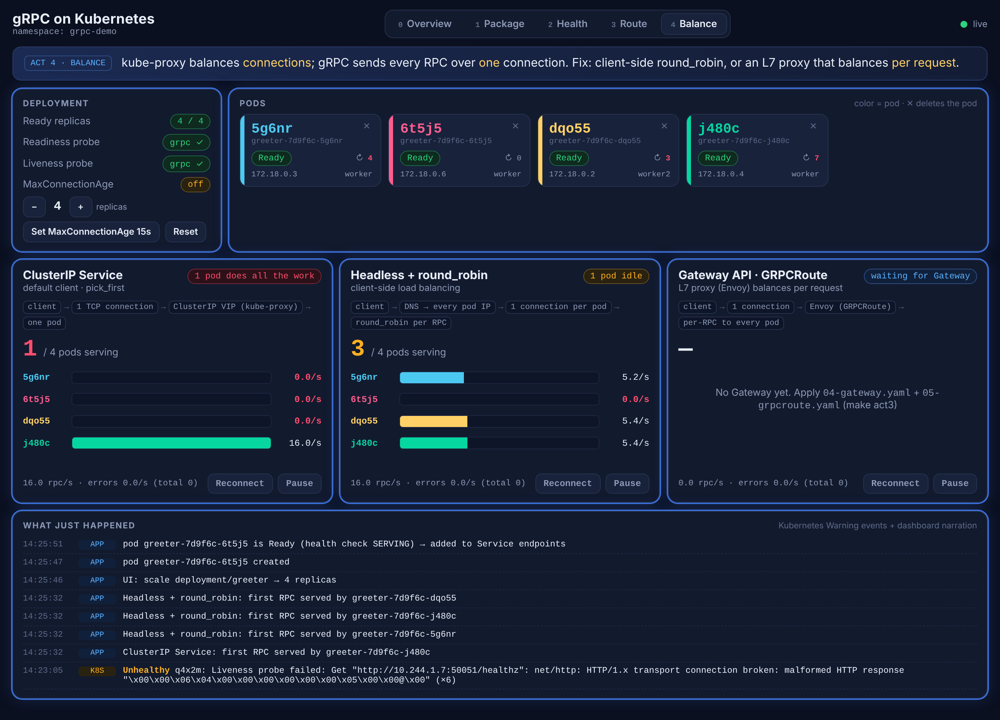

# Your First gRPC Service on Kubernetes — Demo Runbook

> **Presenting with the live dashboard?** Follow **[DEMO-SCRIPT.md](DEMO-SCRIPT.md)**: what to type, where to point, and what to say for every act.
> Quick start: `make setup` → `make stage` → `make ui` → open http://localhost:8081



A live demo in four acts: **package it → health-check it → route it → load-balance it.**
Each act starts with the mistake beginners usually make, then shows the fix. The same image is used throughout, and its behaviour is switched with env vars.

```
.
├── proto/greeter/v1/greeter.proto      # tiny API; every reply includes the serving pod's name
├── gen/                                # generated Go code (committed, so no protoc on stage)
├── cmd/server/                         # gRPC server: health service, reflection, graceful drain, MaxConnectionAge
├── cmd/client/                         # load client: ONE ClientConn, prints per-pod histogram
├── cmd/dashboard/                      # live web UI: 3 traffic lanes + pods + events, runs in-cluster
├── Dockerfile                          # multi-stage → distroless, non-root
├── kind-config.yaml                    # 1 control plane + 2 workers
├── k8s/
│   ├── 00-namespace.yaml
│   ├── 01-deployment-WRONG-probes.yaml # httpGet probes → restart loop
│   ├── 02-deployment.yaml              # native grpc probes, readiness vs liveness, preStop
│   ├── 03-services.yaml                # ClusterIP + headless, appProtocol: kubernetes.io/h2c
│   ├── 04-gateway.yaml                 # GatewayClass + Gateway (Envoy Gateway)
│   ├── 05-grpcroute.yaml               # GRPCRoute matched on gRPC service/method
│   └── 06-dashboard.yaml               # dashboard + least-privilege RBAC
├── scripts/lb-test.sh                  # runs the client in-cluster, prints the tally
├── CHECKLIST.md                        # the take-home slide
├── DEMO-SCRIPT.md                      # presenter script for the dashboard version
└── Makefile                            # `make help` lists every step
```

## Prerequisites (laptop)

`docker`, `kind`, `kubectl`, `helm`, `grpcurl`. Run `make prereqs` to check them.

**Do this before you go on stage.** It downloads images and is the slowest step:

```bash
make setup        # kind cluster + Envoy Gateway (EG_VERSION=v1.6.1 by default; override if newer)
make build        # build + kind load
```

Between rehearsals, run `make reset`. It keeps the cluster and Envoy Gateway and deletes the app.

Use **two terminals** on stage. Terminal A runs the commands. Terminal B runs `kubectl -n grpc-demo get pods -w`, and later `make gw-forward` and `make act4-watch`.

---

## Act 1 - Package it (≈3 min)

```bash
make act1
```

**Show:** the image is a few MB. `sh` doesn't exist in it (distroless).

**Say:**
- Generated code is committed, so the build only needs Go. That's one less tool in CI.
- Use a static binary, distroless, and a **numeric** `USER 65532`. With a named user, `runAsNonRoot: true` fails ("image has non-numeric user"). Beginners hit that one constantly.
- There's no shell, so no `grpc_health_probe` binary to exec. That's why Act 2 uses the kubelet's native probe.

## Act 2 - Health checks (≈5 min)

### 2a: the copy-paste mistake

```bash
make act2-wrong
kubectl -n grpc-demo describe pod -l app=greeter | grep -A1 'probe failed' | head -4
```

**Expected:** `READY 0/1`, and `RESTARTS` keeps climbing. The events show something like
`Liveness probe failed: Get "http://10.244.x.x:50051/healthz": net/http: HTTP/1.x transport connection broken: malformed HTTP response "\x00\x00\x06\x04..."`

**Say:** "`httpGet` speaks HTTP/1.1. gRPC speaks HTTP/2 only. Those bytes are an HTTP/2 SETTINGS frame. The server is fine, but the probe can't talk to it." This is the **same root cause** as the classic Ingress breakage: anything in the path that only speaks HTTP/1.1 breaks gRPC.

Optional one-liner to show the same thing by hand:
`kubectl -n grpc-demo run curl --rm -i --image=curlimages/curl --restart=Never -- curl -sS --http1.1 http://<pod-ip>:50051/` → `Received HTTP/0.9 when not allowed`

### 2b: native gRPC probes

```bash
make act2-fix
```

**Expected (Terminal B):** new pods sit at `0/1 Running` for about 8s (warm-up), then flip to `1/1`. No restarts.

**Walk through `02-deployment.yaml`:**
- `grpc: { port: 50051 }` makes the kubelet call `grpc.health.v1.Health/Check`. This is GA since 1.27.
- ⚠️ `port` must be a **number**. Named ports are not supported for gRPC probes.
- **Readiness** asks `service: ""`, meaning "can I take traffic?". It is NOT_SERVING during warm-up.
  **Liveness** asks `service: liveness`, meaning "is the process alive?". It stays SERVING during warm-up, so a slow start never causes a restart loop.
- On SIGTERM the server flips health to NOT_SERVING and then drains with `GracefulStop()`. `preStop: sleep` gives endpoints time to update first.

## Act 3 - Route it with GRPCRoute (≈5 min)

```bash
make act3
make gw-forward      # Terminal B (leave running)
make act3-call       # Terminal A
```

**Expected:**
```
greeter.v1.Greeter
grpc.reflection.v1.ServerReflection
grpc.reflection.v1alpha.ServerReflection
{ "message": "Hello, KCD!", "pod": "greeter-xxxxxxxxxx-abcde" }

▶ Wrong hostname -> no route matches:
ERROR: ... unexpected HTTP status code received from server: 404 (Not Found)
```

**Walk through `05-grpcroute.yaml`:** it matches on `method.service` (and optionally `method.method`). Those are gRPC concepts, not URL paths or vendor annotations. Then point out the role split: GatewayClass belongs to the platform team, Gateway to the operator, GRPCRoute to the app team. Also mention `appProtocol: kubernetes.io/h2c` on the Service. It's the portable way to say "talk HTTP/2 to me".

**Framing:** Ingress NGINX, the controller most beginner tutorials still use (with `backend-protocol: "GRPC"` annotations), was retired in March 2026. It no longer gets releases or security fixes. Gateway API is the recommended path.

## Act 4 - The load-balancing surprise (≈7 min, the highlight)

### 4a: the problem

```bash
make act4-problem
```

**Expected :**
```
target=greeter.grpc-demo.svc.cluster.local:50051  lb=pick_first  (one ClientConn, reused for every RPC)
── result ── 300 requests, 1 pod(s) hit
  greeter-7c9f...-x2kqp                  300  ████████████████████████████████████████
```

**Say:** "Three replicas, and one does all the work. kube-proxy balances **connections**, not requests. gRPC opens **one** HTTP/2 connection and multiplexes every RPC over it. Kubernetes did exactly what it promised, just not what we expected."

### 4b: fix #1, client-side load balancing

```bash
make act4-fix-client
```
```
target=dns:///greeter-headless...:50051  lb=round_robin
── result ── 300 requests, 3 pod(s) hit
  greeter-...-a    100  █████████████
  greeter-...-b     99  █████████████
  greeter-...-c    101  █████████████
```
The fix has three parts: a **headless** Service (DNS returns pod IPs), the `dns:///` scheme, and `round_robin`. If you leave out any one of them, you're back to a single pod. A good audience question is "what if I use the headless service but keep pick_first?" The answer is still one pod.

### 4c: fix #2, let an L7 proxy do it

```bash
make act4-fix-gateway
```
The same 300 RPCs go through Envoy, which balances **per request**, with zero client changes. This is the same idea behind a service mesh.

### 4d: the sequel (if time allows), new pods get no traffic

```bash
make act4-watch      # Terminal B: tally every 10s
make act4-scale      # Terminal A: 3 → 4 replicas
```
The 4th pod becomes Ready but gets **0** requests, because the client resolved DNS once and has healthy connections, so it never looks again.

```bash
make act4-conn-age   # sets MAX_CONN_AGE=15s (rolls pods); restart act4-watch, then scale to 5
```
Now the server sends GOAWAY every 15s. The client reconnects, re-resolves, and the new pod shows up in the tally.
**Timing note:** grpc-go re-resolves DNS at most every **30s**, so expect the new pod to appear about 30s after scaling, not instantly. Keep talking through that gap. In the local rehearsal, the new pod went from 0 → steadily growing in that window. Without MaxConnectionAge it stayed at 0 the whole time.

---

## What was verified while building this

- Server and client compile against grpc-go v1.80.0 / protobuf-go v1.36.11 and pass `go vet`.
- Behaviour was rehearsed with containers on a Docker network, where a shared DNS alias stands in for a headless Service: warm-up NOT_SERVING→SERVING, liveness staying SERVING, the HTTP/1.1 failure, pick_first (300/0/0) vs round_robin (100/99/101), new-replica starvation, and the MaxConnectionAge recovery.
- All manifests pass `kubeconform -strict` against Kubernetes 1.34 and Gateway API schemas.
